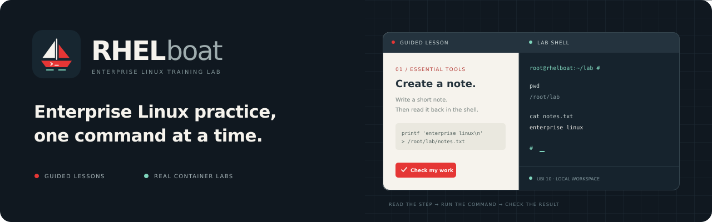
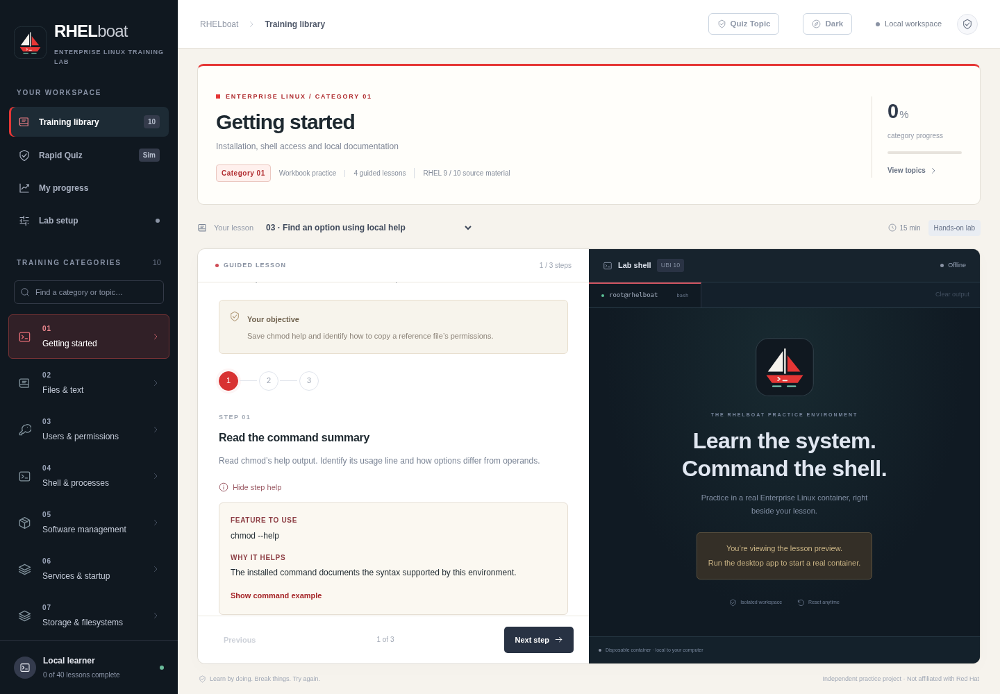

<p align="center">
  
</p>

# RHELboat · Enterprise Linux Training Lab

**Enterprise Linux practice, one command at a time.**

RHELboat guides you through installing a real RHEL system from an official ISO, then puts Linux lessons beside an isolated container shell. Follow the next step, practice it, and inspect the result.

[Get started](#run-rhelboat) · [Training categories](#training-categories) · [Contribute](CONTRIBUTING.md) · [Brand assets](docs/BRANDING.md)



[View lab setup](docs/assets/lab-setup.png)

## Learn beside the shell

| Guided learning                                       | Hands-on practice                                       | Your own workspace                                                          |
| ----------------------------------------------------- | ------------------------------------------------------- | --------------------------------------------------------------------------- |
| 40 original lessons across 10 subject categories      | 15 container labs with checks against the actual result | Local progress, persistent lab files, and reset when you need a fresh start |
| Topic quizzes and help explaining each tool’s purpose | Real Bash through Podman or Docker                      | RHEL installation VM plus marked full-system guides                         |

Lessons follow the subjects in your local System Administration I and II workbooks, the RHEL 10 study guide, and diagnostic practice notes. The language-models book is excluded. Guided explanations and scenarios are original adaptations with PDF page references; the app does not embed complete books or reproduce their question sets.

Each step includes **Help with this step**: the relevant feature, why it is useful, and an optional command example. Examples for full-system tasks are shown for the guest console. Only container examples can be inserted into the container shell.

## Run RHELboat

Use **Linux** and **Node.js 24+**. Container exercises need **Podman or Docker**, available to your user; Docker must be running. The installation lab separately needs **QEMU**, `qemu-img`, and QEMU GTK display support. The first container start needs internet access to build the UBI 10 image; download the RHEL ISO yourself from Red Hat for the VM lab.

```sh
git clone https://github.com/ochoaj92-lgtm/RHELboat.git
cd RHELboat
npm install
npm run dev
```

### Install on Arch Linux (pacman & makepkg)

You can build and install directly with Arch Linux's `makepkg` and `pacman`:

```sh
git clone https://github.com/ochoaj92-lgtm/RHELboat.git
cd RHELboat
makepkg -si
```

This packages RHELboat against your system's Electron, installs desktop integration and icons, and enables launching with `rhelboat`.

Bun 1.3+ can install the existing lockfile with `bun install --frozen-lockfile`; the app scripts use Node.js.

1. Choose a training category and topic.
2. For the installation lesson, use the VM panel to get an ISO, verify it, configure the VM, and start installation. Its QEMU console opens in a separate window beside the guide.
3. For container exercises, select your runtime in **Lab setup**, or use **Start lab environment** beside the lesson. **Use in shell** inserts a command hint; press Enter to run it.
4. Use **Check my work** to verify a container lab. Installation checkpoints and other VM or multiple-VM labs require saved step confirmations and use self-reported completion.

To browse lessons without launching the desktop app:

```sh
npm run preview
```

The browser preview shows the curriculum. Container execution, ISO selection and VM controls are available through the desktop app.

## Install RHEL hands-on

The Getting started lesson, **Install RHEL from the official ISO**, follows the real installation workflow with saved checkpoints:

1. Open [Red Hat's download page](https://developers.redhat.com/products/rhel/download), sign in yourself, and choose the release and architecture for your preparation. The current VM launcher uses x86_64. Prefer the DVD ISO for a self-contained installation; Boot ISO needs an additional source.
2. Select the downloaded ISO in the app, paste the matching 64-character SHA-256 value from Red Hat, and verify it. No release checksum or expiring download URL is hardcoded. A match confirms the selected bytes against the value you supplied; you must obtain that value from the official source.
3. Configure the practice VM. **2 vCPUs, 4096 MiB RAM and a 40 GiB virtual disk** are suggested lab settings, not Red Hat's minimum requirements. RHEL 10 x86_64 requires [x86-64-v3 CPU features](https://docs.redhat.com/en/documentation/red_hat_enterprise_linux/10/html/10.0_release_notes/architectures). Compatible KVM acceleration is preferred; the software-emulation option is much slower.
4. Arrange the separate QEMU console beside the guide. Work through media checking, language, keyboard, destination and storage, software source, network, hostname, timezone and administrator-account creation.
5. Review the selected virtual disk and install. Shut down cleanly from the guest when complete, then use **Boot installed disk** to start without the ISO. Inspect the installed system and repeat the checks after a normal reboot.

Follow the [official RHEL 10 interactive installation documentation](https://docs.redhat.com/en/documentation/red_hat_enterprise_linux/10/html-single/interactively_installing_rhel_from_installation_media/index) for your selected release. RHELboat does not sign in, accept Red Hat membership or license terms, download an entitled ISO automatically, or register the guest on your behalf. Passwords are entered directly in your browser or the VM console.

Installation is the foundation for boot, storage, networking and account practice. The app verifies the ISO and manages the VM but does not automatically grade installer choices or guest configuration. Step confirmations record the learner’s own observations.

The VM's persistent disk is stored in `installation-vm/` inside Electron's application user-data directory. It is separate from container files and progress; container reset does not erase it. The launcher attaches no host raw disks or shared host folders. The VM uses its own user-mode network, while the container labs retain their separate network isolation.

**Closing RHELboat leaves this separate VM running.** Shut down from the guest or request graceful shutdown in the VM panel, then wait for it to stop. The app provides no forced power-off or VM-disk deletion control. Do not close the QEMU window while the installer or guest is writing to disk.

## Training categories

| Category                     | Topics                                                          |
| ---------------------------- | --------------------------------------------------------------- |
| Getting started              | Installation, navigation, documentation, shell environment      |
| Files & text                 | Links, archives, filtering, searching, editing                  |
| Users & permissions          | Accounts, access bits, group collaboration, password aging      |
| Shell & processes            | Jobs, executable scripts, loops, scheduling                     |
| Software management          | RPM, DNF, repositories, Flatpak                                 |
| Services & startup           | systemd, journal, time, recovery, Kickstart                     |
| Storage & filesystems        | Mounts, LVM, swap, NFS, encrypted volumes                       |
| Networking & remote access   | Profiles, DNS, SSH, secure file transfer                        |
| System security              | SELinux, firewalld                                              |
| Operations & troubleshooting | Containers, performance, faults, authentication, tracing, iSCSI |

**15 container labs** verify actual state. **25 VM or multiple-VM labs** list their prerequisites, require step confirmations, and record self-reported practice. The installation VM can be booted from other single-VM topics. Extra disks, snapshots, additional guests and product infrastructure must be prepared using your virtualization tools; the app does not provision or grade those environments.

Use **Workbook references** to see the source title, release, section and PDF page range. **Open local PDF** opens a registered file from `training/` in the desktop PDF reader. In a packaged app, place personal copies in a `training/` folder beside the application resources (or inside the application directory for system Electron installs). Missing PDFs do not prevent the adapted lessons from working. The raw PDFs are kept local and excluded from Git and distributable packages.

The sources cover both RHEL 9 and 10. Follow the source version shown beside a lesson, inspect your installed command’s documentation, and account for release differences. Legacy diagnostic notes supply investigation topics; their old commands and answer text are not treated as current procedures. See [the full topic-to-source map](docs/TRAINING.md).

Existing checked lesson progress and installation checkpoints are retained. Retired certification-only guides are removed; new VM lab completion requires its own saved step confirmations. Progress export/import includes these confirmations.

## How the lab works

The desktop app builds [labs/Containerfile](labs/Containerfile) into `localhost/rhelboat-lab:v1` and creates `rhelboat-lab` in the selected runtime. It verifies its ownership label before starting, stopping, or removing that container.

- No host directories or container socket are mounted.
- Runtime networking is disabled after the image is built.
- The lab is limited to 1 CPU, 768 MiB RAM, and 128 processes, with reduced capabilities and no new privileges.
- **Stop** and normal app close preserve files. **Reset** confirms deletion of that runtime's lab container and recreates it.
- Progress is stored locally and kept when the lab resets. Podman and Docker maintain separate lab containers.

The image and writable container layer use local disk space. The installation VM has its own persistent virtual disk and lifecycle, as described above. Other full-system guides need their own appropriate practice environments.

## Build and verify

```sh
npm run typecheck
npm test
npm run build
npm run build:linux
```

`build` writes the Electron main process and renderer to `build/`. `build:linux` packages AppImage, DEB, RPM, and tar archives into `dist/`, including the Containerfile for local lab creation. A generated unpacked build can be launched with `./dist/linux-unpacked/rhelboat`.

RPM packaging also requires your distribution's `rpmbuild` tool (`rpm` on Debian/Ubuntu, `rpm-build` on RHEL/Fedora). To build the other formats without it, run `npm run build` followed by `npx electron-builder --linux AppImage deb tar.bz2`.

Default tests check curriculum integrity, execute file exercises in temporary directories, and verify container isolation, ownership protection, input validation, and lifecycle behavior using a fixture runtime. To exercise the actual Podman shell and all 15 checked lessons:

```sh
RHELBOAT_LIVE_TEST=1 node --test tests/lab.test.ts
```

The live test refuses to run if `rhelboat-lab` already exists. It removes only its own test container and leaves the cached image.

## Contributing

Improvements to explanations, accessibility, lab checks, and workbook topic coverage are welcome. Start with [CONTRIBUTING.md](CONTRIBUTING.md). Report application issues in the [RHELboat issue tracker](https://github.com/ochoaj92-lgtm/RHELboat/issues); see [SECURITY.md](SECURITY.md) for security reports.

Brand sources, icon exports, and artwork conventions are documented in [docs/BRANDING.md](docs/BRANDING.md). Repository About text and social-preview settings are listed in [.github/PROJECT.md](.github/PROJECT.md).

## Credits and license

RHELboat is an independent project adapted from [WinBoat](https://github.com/TibixDev/winboat) by TibixDev. The original copyright notice and MIT terms are preserved in [LICENSE](LICENSE). The trainer runs through its own Electron entry point.

Practice explanations, quizzes and scenarios are original adaptations of the subjects in the locally supplied books. Complete source PDFs are not bundled. Red Hat and RHEL are trademarks of Red Hat, Inc. RHELboat is not affiliated with or endorsed by Red Hat.
